<a href="https://skrpions.github.io/nestor-dev">
</a>

<picture>
  <source media="(prefers-color-scheme: dark)" srcset="assets/title-sobre-mi-dark.svg">
  
</picture>

<picture>
  <source media="(prefers-color-scheme: dark)" srcset="assets/title-hechos-dark.svg">
  
</picture>
<a href="https://acofipapers.org/index.php/eiei/article/view/252"> 
</a>

<picture>
  <source media="(prefers-color-scheme: dark)" srcset="assets/title-trabajo-dark.svg">
  
</picture>



<a href="https://github.com/skrpions/skills_inventory_web"></a>

<a href="https://github.com/skrpions/sigma-web"></a>


 

<picture>
  <source media="(prefers-color-scheme: dark)" srcset="assets/title-herramientas-dark.svg">
  
</picture>

<picture>
  <source media="(prefers-color-scheme: dark)" srcset="assets/title-flujo-dark.svg">
  
</picture>

<picture>
  <source media="(prefers-color-scheme: dark)" srcset="assets/title-formacion-dark.svg">
  
</picture>
<a href="https://skrpions.github.io/nestor-dev"></a>

<picture>
  <source media="(prefers-color-scheme: dark)" srcset="assets/title-contacto-dark.svg">
  
</picture>

<a href="https://skrpions.github.io/nestor-dev">
</a>
